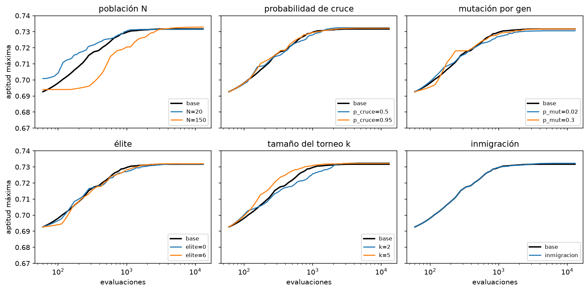

# Del silbido al piano: informe

IA, Universidad Católica Boliviana. Examen práctico grupal de Algoritmos Genéticos.
Integrantes: ______________________ y ______________________

## Resumen

Un algoritmo genético (AG) hecho desde cero evoluciona los 12 parámetros de un piano sintético aditivo para que suene
parecido a 5 notas reales (D4, F4, A4, C5, D5). El mejor individuo toca la melodía del silbido (24 notas, bajadas 2
octavas). El fitness A vale 1 / (1 + d/10), donde d es el error medio en dB entre los espectrogramas de la nota
sintética y la real.

Con 10 semillas el AG llega a 0.7321 ± 0.0005, contra 0.7164 ± 0.0032 de una búsqueda aleatoria con 6000 evaluaciones.
Los números salen de `resultados/*.csv`; los pocos que vienen de una salida del notebook llevan la marca (notebook).
Las figuras se generan en `silbido_piano.ipynb` y se guardan en `informe/figuras/`. Las notas de piano son del
Steinway B de la Universidad de Iowa (Musical Instrument Samples, https://theremin.music.uiowa.edu/MIS.html).

## 1. ¿Cómo influye la representación del cromosoma en la eficiencia del AG?

El cromosoma tiene 12 genes reales en [0, 1]: las amplitudes de los armónicos 2 a 6, el ataque, las dos caídas (rápida
y lenta), el peso `m` entre ambas, `s`, la inarmonicidad `B` y el ruido del golpe. `decodificar` los lleva a su rango
físico. Las notas no están en el cromosoma: el instrumento evolucionado toca cualquier melodía después.

La representación decide el tamaño del espacio y qué tan bien funcionan los operadores. Con 100 niveles por gen hay
10^24 instrumentos posibles (notebook), imposible de recorrer entero, pero con 12 genes el AG sí puede explorarlo.
Además, como todos los genes están en [0, 1], un mismo sigma de mutación (0.1) y un mismo alpha de cruce (0.3) sirven
para todos.

Un ejemplo de mala codificación sería guardar los genes en unidades físicas. Sus rangos van de 0.002 (`B`) a 2.7
(`tau_lento`), 1350 veces de diferencia, y una mutación de 0.1 sería 50 veces el rango de `B`, que quedaría siempre en
un extremo. Otra mala sería meter las 24 notas en el cromosoma: más genes y un fitness que mezcla melodía con timbre.
La codificación elegida evita las dos. Ninguna alternativa se probó, así que esto es un argumento y no un resultado.

La Figura 1 muestra cuánto pesa cada gen: `a2`, `m` y `a4` bajan el fitness más de 0.012 con un cambio del 10 %, y
`tau_rapido` y `tau_lento` lo mueven menos de 0.001. Dos de los 12 genes casi no influyen.

 <em>Figura 1. Cambio del fitness A al mover cada gen ±10 % de su rango desde el mejor individuo.</em>

## 2. ¿Qué es una superficie de fitness y por qué debe ser suave?

La superficie de fitness es la altura (la aptitud) que le toca a cada combinación de genes, y el AG busca su parte más
alta. Cruce y mutación crean hijos cerca de sus padres, así que el AG avanza solo si "cerca" en los genes significa
"parecido" en fitness. Con saltos o muchos picos, un buen padre no daría buenos hijos y la búsqueda se parecería al azar.

La Figura 2 recorre cada gen de 0 a 1 en 41 pasos desde el mejor individuo (`superficie.csv`). Nueve de los 12 cortes
tienen un solo pico. Entre puntos vecinos (paso de 0.025) el fitness cambia como mucho 0.011, salvo en `m` (0.035),
mientras que la caída total llega hasta 0.083. `ataque` y `B` tienen picos pequeños extra (8 y 4), pero el rango
total de `ataque` es de solo 0.019. La superficie es bastante suave, aunque solo vimos cortes de un gen a la vez y no
sabemos cómo interactúan entre ellos.

Además del fitness A se implementó el B, la correlación entre espectrogramas. En 60 individuos al azar, B tiene media
0.870 y máximo 0.901 (rango estrecho), y su correlación con A es −0.04 (notebook). Casi no se parecen, y como B
distingue poco, toda la evolución usa A.

 <em>Figura 2. Fitness A al recorrer cada gen de 0 a 1; la línea punteada es el valor del mejor individuo.</em>

## 3. Exploración contra explotación

Explorar es buscar en zonas nuevas y explotar es afinar lo ya encontrado. Como medida se usa la diversidad
(desviación estándar media de los genes de la población): alta es explorar, baja es explotar. La Tabla 1 compara las
tres combinaciones con 5 semillas (2026 a 2030) y la Figura 3 muestra la diversidad por generación.

| combinación | aptitud final | generaciones hasta 90 % de la mejora | generaciones hasta diversidad < 0.05 | diversidad final | evaluaciones |
| --- | --- | --- | --- | --- | --- |
| C1 torneo + blend + gaussiana | 0.7316 ± 0.0007 | 13.4 | 13.8 | 0.026 | 3890 |
| C2 ruleta + uniforme + uniforme | 0.7248 ± 0.0022 | 26.8 | nunca | 0.252 | 3425 |
| C3 torneo + blend + no uniforme | 0.7319 ± 0.0003 | 12.8 | 22.4 | 0.014 | 4732 |

*Tabla 1. Media (y desviación) de 5 semillas. La mejora se mide del Gen 0 a la aptitud final.*

C2 explora: casi no pierde diversidad (de 0.284 a 0.252) y sube despacio. C1 y C3 explotan: la diversidad cae bajo 0.05
en unas 14 y 22 generaciones y terminan más arriba.

¿Qué operador empuja hacia cada lado? Solo la selección se midió por separado. En 60 individuos al azar, el torneo
(k = 3) elige padres con aptitud media 0.610 y la ruleta 0.577, contra 0.573 de la población (notebook): el torneo
presiona más, hacia explotar, y la ruleta casi no, porque las aptitudes se parecen. Por diseño, el cruce blend-alpha y
la mutación gaussiana dejan hijos cerca de los padres (explotación), y la mutación uniforme reinicia un gen en todo
[0, 1] (exploración). Pero cada combinación cambia los tres operadores a la vez, así que los datos no separan el
efecto del cruce y de la mutación.

La hipótesis de que la mutación no uniforme afinaría mejor en C3 no se sostuvo: 0.7319 contra 0.7316 de C1 es menos que
la desviación entre semillas, y C3 gasta 22 % más evaluaciones. Se eligió C1.

<table><tr>
<td> <em>Figura 3. Diversidad por generación (línea gruesa: media; finas: cada semilla).</em></td>
<td> <em>Figura 4. Aptitud máxima contra evaluaciones, una variable a la vez (negro: base).</em></td>
</tr></table>

## 4. Convergencia prematura

Es cuando la población pierde la diversidad antes de encontrar un buen óptimo y se queda atascada en uno mediocre. Se
detecta mirando juntas la diversidad y la aptitud máxima por generación: diversidad que se hunde con aptitud plana. Se
evita con más mutación, con inmigración (reemplazar al 10 % peor por individuos nuevos si la diversidad cae bajo 0.05),
con población grande o con menos presión de selección.

La diversidad sí se hundió: de 0.284 a menos de 0.05 en unas 14 generaciones en C1 y en la base. Pero no se observó
convergencia prematura con daño visible. En las 12 configuraciones (3 semillas cada una, Figura 4) la aptitud media
final está entre 0.7306 y 0.7329, y las corridas sueltas entre 0.7299 y 0.7335. Las que conservan más diversidad no
ganan: la inmigración termina con diversidad 0.118 y aptitud 0.7323, la mutación 0.3 con 0.078 y 0.7317, y la base con
0.026 y 0.7317. La mutación 0.02 pierde casi toda la diversidad (0.0086) y llega a 0.7306, el valor más bajo de las 12,
pero solo 0.0011 bajo la base, parecido a la desviación entre semillas (0.0007).

Con 3 semillas por configuración, las diferencias de milésimas son orientativas. Lo que sí cambia mucho es el costo:
población 20 llega a 0.7314 con 1442 evaluaciones y población 150 a 0.7329 con 12196. Que todas las configuraciones
lleguen casi al mismo valor, mientras la búsqueda aleatoria se queda en 0.716, sugiere que el techo de ~0.73 lo pone
el sintetizador y no el AG.
