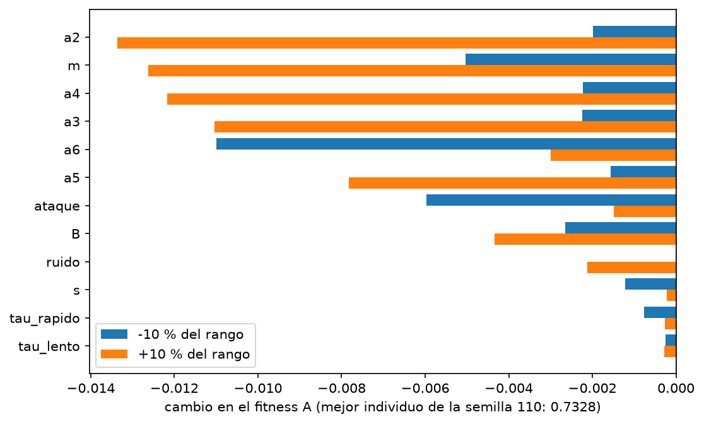
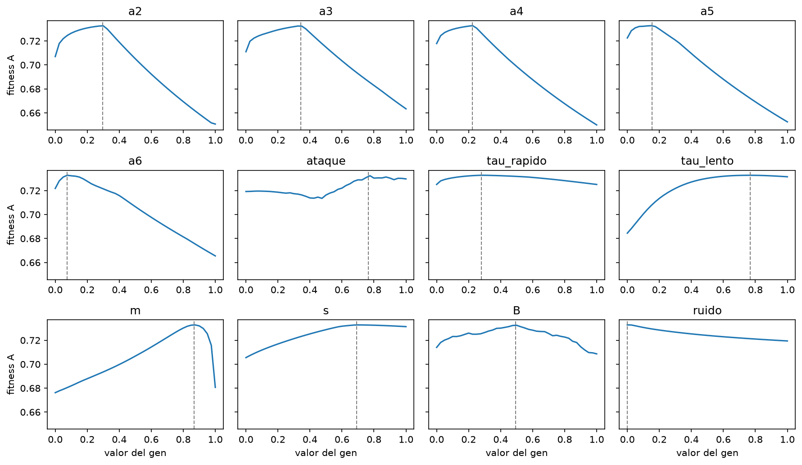
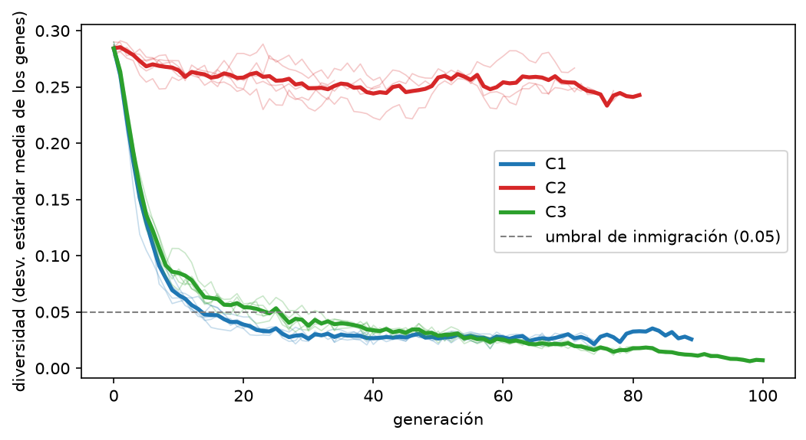
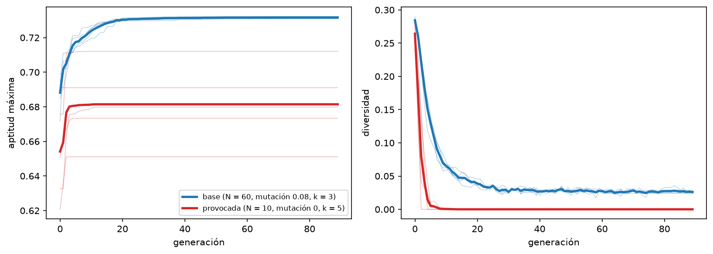
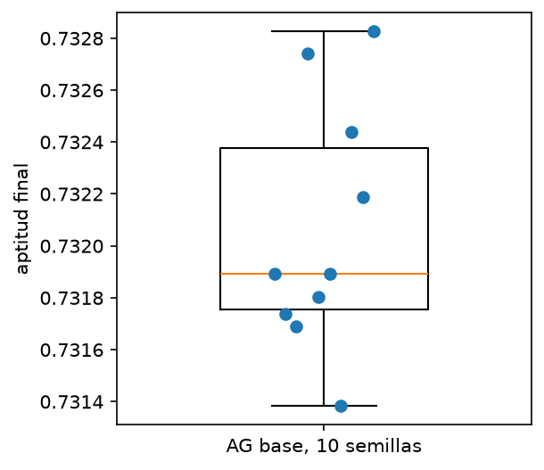
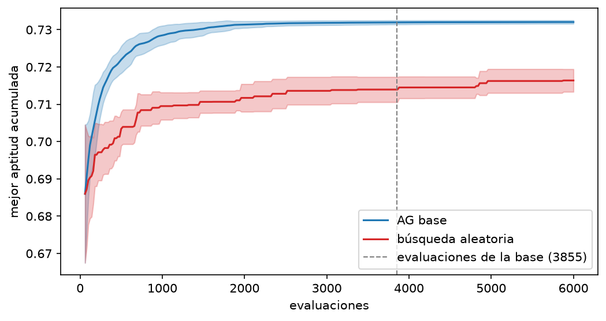
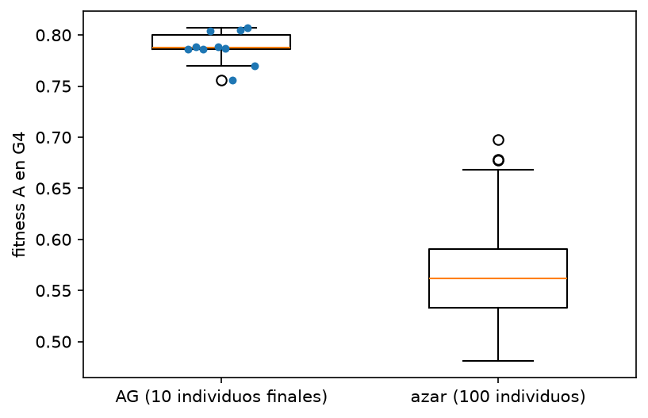

# Del silbido al piano: informe

IA, Universidad Católica Boliviana. Examen práctico grupal de Algoritmos Genéticos.

Integrantes:
- Ariana Aylen Pita Vargas
- Maria Jose Sandoval Orellana

## Resumen

Un algoritmo genético (AG) hecho desde cero evoluciona los 12 parámetros de un piano sintético aditivo para que suene
parecido a 5 notas reales (D4, F4, A4, C5, D5). El mejor individuo toca la melodía del silbido (24 notas, bajadas 2
octavas). El fitness A vale 1 / (1 + d/10), donde d es el error medio en dB entre los espectrogramas de la nota
sintética y la real.

Con 10 semillas el AG llega a 0.7321 ± 0.0005, contra 0.7164 ± 0.0032 de una búsqueda aleatoria con 6000 evaluaciones.
Los números salen de `resultados/*.csv`; los pocos que vienen de una salida del notebook llevan la marca (notebook).
Las figuras salen de `silbido_piano.ipynb`. Las notas de piano son del Steinway B de la Universidad de Iowa
(Musical Instrument Samples, https://theremin.music.uiowa.edu/MIS.html).

## 1. ¿Cómo influye la representación del cromosoma en la eficiencia del AG?

El cromosoma tiene 12 genes reales en [0, 1] (amplitudes de los armónicos 2 a 6, ataque, dos caídas, `m`, `s`,
inarmonicidad `B` (Fletcher y Rossing, 1998) y ruido del golpe), que `decodificar` lleva a su rango físico. Las notas
no están en el cromosoma: el instrumento evolucionado toca cualquier melodía después.

La representación decide el tamaño del espacio y cómo actúan los operadores. Con 100 niveles por gen hay 10^24
instrumentos posibles (notebook), imposible de recorrer entero. Como todos los genes están en [0, 1], el mismo sigma
de mutación (0.1) y el mismo alpha de cruce (0.3) sirven para todos.

Una mala codificación sería guardar los genes en unidades físicas: sus rangos van de 0.002 (`B`) a 2.7 (`tau_lento`)
y una mutación de 0.1 sería 50 veces el rango de `B`. Otra, meter las 24 notas en el cromosoma. La elegida evita ambas.
Ninguna alternativa se probó, así que es un argumento y no un resultado.

La Figura 1 muestra cuánto pesa cada gen: `a2`, `m` y `a4` bajan el fitness más de 0.012 con un cambio del 10 %, y
`tau_rapido` y `tau_lento` lo mueven menos de 0.001. Dos de los 12 genes casi no influyen.

 <em>Figura 1. Cambio del fitness A al mover cada gen ±10 % de su rango desde el mejor individuo.</em>

## 2. ¿Qué es una superficie de fitness y por qué debe ser suave?

La superficie de fitness es la aptitud que le toca a cada combinación de genes; el AG busca su parte más alta. Cruce
y mutación crean hijos cerca de sus padres, así que el AG avanza solo si "cerca" en los genes significa "parecido" en
fitness. Con saltos o muchos picos, un buen padre no daría buenos hijos y la búsqueda se parecería al azar.

La Figura 2 recorre cada gen de 0 a 1 en 41 pasos desde el mejor individuo (`superficie.csv`). Nueve de los 12 cortes
tienen un solo pico. Entre puntos vecinos (paso de 0.025) el fitness cambia como mucho 0.011, salvo en `m` (0.035),
mientras que la caída total llega hasta 0.083. `ataque` y `B` tienen picos pequeños extra (8 y 4), pero el rango
total de `ataque` es de solo 0.019. La superficie es bastante suave, aunque solo vimos cortes de un gen a la vez y no
sabemos cómo interactúan entre ellos.

Además del fitness A se implementó el B (correlación entre espectrogramas). En 60 individuos al azar, B tiene media
0.870 y máximo 0.901, un rango estrecho, y su correlación con A es −0.04 (notebook); por eso toda la evolución usa A.

Se eligió la correlación espectral en vez del croma porque el croma suma toda la energía de cada clase de nota (do,
do#, re…) sin importar la octava. Para una sola nota de piano, la fundamental y los armónicos 2 y 4 caen en la misma
clase, y el 3 y el 6 en la quinta. Así se pierde justo lo que el AG intenta ajustar: la proporción entre armónicos y
cómo decae cada uno. El croma sirve para comparar melodías o acordes, no el timbre de una nota.

No se usó el MSE sobre la onda cruda porque depende de la fase: dos notas con el mismo timbre, pero desfasadas medio
periodo, darían un error máximo. El oído percibe el timbre por la energía de cada frecuencia en escala logarítmica, no
por la forma exacta de la onda. La STFT en dB descarta la fase y comprime el rango dinámico, así que compara lo que se
oye. Con MSE la superficie de fitness sería mucho más irregular. No se probó; es un argumento.

 <em>Figura 2. Fitness A al recorrer cada gen de 0 a 1; la línea punteada es el valor del mejor individuo.</em>

## 3. Exploración contra explotación

Explorar es buscar en zonas nuevas y explotar es afinar lo ya encontrado. Se mide con la diversidad (desviación
estándar media de los genes): alta es explorar, baja es explotar. La Tabla 1 compara las tres combinaciones con 5
semillas (2026 a 2030) y la Figura 3 muestra la diversidad por generación. El cruce blend-alpha sigue a Eshelman y
Schaffer (1993) y la mutación no uniforme a Michalewicz (1996).

| combinación | aptitud final | generaciones hasta 90 % de la mejora | generaciones hasta diversidad < 0.05 | diversidad final | evaluaciones |
| --- | --- | --- | --- | --- | --- |
| C1 torneo + blend + gaussiana | 0.7316 ± 0.0007 | 13.4 | 13.8 | 0.026 | 3890 |
| C2 ruleta + uniforme + uniforme | 0.7248 ± 0.0022 | 26.8 | nunca | 0.252 | 3425 |
| C3 torneo + blend + no uniforme | 0.7319 ± 0.0003 | 12.8 | 22.4 | 0.014 | 4732 |

*Tabla 1. Media (y desviación) de 5 semillas. La mejora se mide del Gen 0 a la aptitud final.*

C2 explora: casi no pierde diversidad (de 0.284 a 0.252) y sube despacio. C1 y C3 explotan: la diversidad cae bajo 0.05
en unas 14 y 22 generaciones y terminan más arriba. C2 junta tres cambios; la Tabla 2 los separa.

| cambio respecto a la base | aptitud final | evaluaciones hasta 90 % de la mejora | diversidad final |
| --- | --- | --- | --- |
| ninguno (base) | 0.7317 ± 0.0007 | 793 | 0.026 |
| selección: ruleta | 0.7267 ± 0.0025 | 3734 | 0.077 |
| cruce: uniforme | 0.7325 ± 0.0005 | 955 | 0.028 |
| mutación: uniforme | 0.7318 ± 0.0007 | 799 | 0.107 |
| mutación: no uniforme | 0.7318 ± 0.0004 | 862 | 0.015 |

*Tabla 2. Media de 3 semillas (2026 a 2028), un operador distinto a la vez.*

La selección es la que más pesa: con ruleta la aptitud baja a 0.7267 y hacen falta 3734 evaluaciones para recorrer el
90 % de la mejora, 4.7 veces las de la base. La ruleta casi no distingue a los buenos cuando las aptitudes se parecen
(en una población al azar, el torneo elige padres con aptitud media 0.610 y la ruleta 0.577; notebook), así que empuja
hacia explorar, y de más: casi todo el retraso de C2 viene de ahí. La mutación uniforme también explora: deja la
diversidad final en 0.107, cuatro veces la de la base, sin perder aptitud ni velocidad. El cruce uniforme casi no
cambia nada, y la mutación no uniforme es la que más baja la diversidad (0.015). Con 3 semillas solo lo de la ruleta
supera claramente el ruido entre semillas; el resto es orientativo.

La hipótesis de que la mutación no uniforme afinaría mejor en C3 no se sostuvo: 0.7319 contra 0.7316 de C1 es menos que
la desviación entre semillas, y C3 gasta 22 % más evaluaciones. Se eligió C1.

<table><tr>
<td> <em>Figura 3. Diversidad por generación (línea gruesa: media; finas: cada semilla).</em></td>
<td> <em>Figura 4. Aptitud máxima y diversidad: base contra la configuración que provoca convergencia prematura.</em></td>
</tr></table>

## 4. Convergencia prematura

Es cuando la población pierde la diversidad antes de encontrar un buen óptimo y queda atascada en uno mediocre. Se
detecta mirando juntas la diversidad y la aptitud máxima: diversidad que se hunde con aptitud plana. Se evita con más
mutación, inmigración (reemplazar al 10 % peor si la diversidad cae bajo 0.05), población grande o menos presión de
selección.

Para ver cómo luce se provocó a propósito: población 10, mutación 0 y torneo k = 5, con 5 semillas (`prematura.csv`,
Figura 4). Aquí sí apareció. La diversidad bajó de 0.05 en solo 3 generaciones (entre 2 y 4) contra 13.8 de la base, y
terminó en 0: todos los individuos quedaron iguales y el AG ya no puede mejorar. La última mejora fue en la generación
4.4 en promedio y la corrida paró a las 24.8 generaciones con 46 evaluaciones. La aptitud final fue 0.6815 ± 0.0225
(0.6511 a 0.7120) contra 0.7316 ± 0.0007 de la base, y una semilla nunca superó su Gen 0 (0.6910). Como se cambiaron
los tres parámetros a la vez, no sabemos cuál pesa más.

El experimento también muestra deriva genética: sin mutación y con solo 10 individuos, qué genes sobreviven depende
tanto del azar del muestreo como de la aptitud, y la población se fija en un solo individuo (diversidad 0) en pocas
generaciones. En la semilla 2030 toda la población quedó igual al mejor del Gen 0 (0.6910) desde la generación 2.

Con configuraciones razonables, en cambio, no se observó convergencia prematura con daño visible. La diversidad también
cae bajo 0.05 en unas 14 generaciones en la base, pero en las 12 configuraciones (3 semillas) la aptitud media final está
entre 0.7306 y 0.7329. Las que conservan más diversidad no ganan: inmigración (diversidad final 0.118) llega a 0.7323,
mutación 0.3 (0.078) a 0.7317 y la base (0.026) a 0.7317. La mutación 0.02 casi pierde toda la diversidad (0.0086) y
llega a 0.7306, el valor más bajo de las 12, solo 0.0011 bajo la base y parecido a la desviación entre semillas (0.0007).
La base (N = 60, mutación 0.08, k = 3) evita el problema.

Con 3 semillas, las diferencias de milésimas son orientativas. Lo que sí cambia es el costo: población 20 llega a
0.7314 con 1442 evaluaciones y población 150 a 0.7329 con 12196. Que todas lleguen casi al mismo valor, y la búsqueda
aleatoria se quede en 0.716, sugiere que el techo de ~0.73 lo pone el sintetizador y no el AG.

**¿Qué hiperparámetro importa más?** En aptitud final, ninguno de forma clara: las 12 configuraciones quedan entre
0.7306 y 0.7329, dentro del ruido de 3 semillas. En costo, el que más pesa es la población: de 1442 evaluaciones
(N = 20) a 12196 (N = 150), 8.5 veces más por apenas 0.0015 de aptitud. En diversidad final pesan la mutación (0.0086
con 0.02 contra 0.078 con 0.3) y la inmigración (0.118).

## 5. ¿Cómo se demuestra que el AG es mejor que una búsqueda aleatoria?

Se comparó la aptitud final del AG (configuración base, semillas 101 a 110) con la mejor aptitud de una búsqueda
aleatoria con las mismas semillas y las mismas evaluaciones, con la aptitud final, el test de Mann-Whitney (Mann y
Whitney, 1947) y la curva de mejor aptitud acumulada.

El AG llega a 0.7321 ± 0.0005 (0.7314 a 0.7328; Figura 7). El azar con 3855 evaluaciones (lo que gasta en promedio la
configuración base) llega a 0.7140 ± 0.0036, y con 6000 a 0.7164 ± 0.0032. La mejor corrida al azar (0.7229) queda
por debajo de la peor del AG. El test de Mann-Whitney exacto, a una cola (H1: AG mayor que azar), da U = 100, el
máximo posible, y p = 5.4e-6 en ambos casos; a dos colas sería el doble. En la Figura 5 los dos parten igual (0.686 a
las 60 evaluaciones, con la misma población inicial) y el AG supera el valor final medio del azar (0.7164) desde la
evaluación 340.

Sobre el costo: el AG usa 4481 ± 943 evaluaciones (de 2900 a 5603) y 80 ± 17 generaciones; tres corridas llegaron al
tope de 100. Como el promedio supera las 3855 del baseline, también se comparó con 6000, con el mismo resultado.

¿Y si solo aprendió las 5 notas? Con G4 (no usada para entrenar), los 10 individuos finales sacan 0.7878 ± 0.0158 y
100 individuos al azar 0.5653 ± 0.0425 (Figura 6; Mann-Whitney exacto a una cola, U = 1000, p = 2.1e-14). El mejor
individuo saca 0.7695, dentro del rango de sus notas de entrenamiento (0.651 a 0.816, notebook). Hay generalización,
pero limitada: G4 está entre F4 y A4, es interpolación, con una sola nota y el mismo piano; no se probó extrapolar.

<table><tr>
<td> <em>Figura 7. Aptitud final de las 10 corridas de la configuración base (semillas 101 a 110).</em></td>
<td> <em>Figura 5. Mejor aptitud acumulada (media y ±1 desviación de 10 semillas).</em></td>
<td> <em>Figura 6. Fitness A en G4: AG contra individuos al azar.</em></td>
</tr></table>

### Encuesta informal

Cinco personas escucharon el piano real, la nota A4 del Gen 0 y la del mejor evolucionado, y la melodía final, y
respondieron "¿cuánto suena a piano?" (1 a 5) y "¿reconoces la melodía?" (respuestas por WhatsApp).

| persona | piano real | Gen 0 | mejor evolucionado | ¿reconoce la melodía? |
| --- | :---: | :---: | :---: | --- |
| P1 | 5 | 2 | 4 | más o menos |
| P2 | 5 | 1 | 3 | sí |
| P3 | 4 | 2 | 4 | no |
| P4 | 5 | 3 | 4 | más o menos |
| P5 | 5 | 2 | 4 | no |
| **media ± desv.** | **4.8 ± 0.4** | **2.0 ± 0.7** | **3.8 ± 0.4** | 1 sí, 2 más o menos, 2 no |

*Tabla 3. Encuesta informal a 5 personas.*

Las 5 personas le dieron al mejor evolucionado más puntos que al Gen 0 (3.8 contra 2.0), lo que coincide con la
subida del fitness A (0.685 a 0.731): la mejora numérica también se oye. Aun así, queda por debajo del piano real
(4.8) en 4 de las 5 respuestas, consistente con el techo de ~0.73 que atribuimos al sintetizador. La melodía se
reconoce a medias (solo 1 de 5 la reconoció con seguridad), lo que cuadra con la afinación imperfecta del silbido y el
redondeo a notas MIDI. Con 5 personas y sin controlar el equipo de audio, es una señal orientativa, no una prueba.

## Límites

- **Techo.** La aptitud se estanca en ~0.73 en todas las configuraciones. El techo parece venir del sintetizador y no
  del AG, pero es una hipótesis: no se probó otro sintetizador.
- **Pocas semillas.** Con 3 semillas por configuración, las diferencias de milésimas son orientativas.
- **Métrica B.** Tiene rango estrecho y poco acuerdo con A; por eso se evolucionó solo con A.
- **Óptimo.** En el tornado, 23 de los 24 movimientos de ±10 % bajaron el fitness y uno quedó igual (el gen estaba en
  el borde); el barrido de la Figura 2 lo confirma eje por eje. Es consistente con un óptimo local, pero no prueba un
  óptimo global ni descarta mejoras moviendo varios genes a la vez.
- **Decaimiento.** `tau_rapido` y `tau_lento` casi no pesan con ±10 % (menos de 0.001), lo que indica que la métrica
  casi no ve el decaimiento. En el barrido completo `tau_rapido` baja solo 0.0077, pero `tau_lento` baja 0.048: lo nota
  si se aleja mucho.
- **El silbido.** Su afinación es imperfecta (varios intervalos quedan entre dos semitonos, notebook) y la melodía se
  redondea a notas MIDI. No hay una medida numérica de qué tanto se parece la melodía final al silbido; solo los audios
  de `salidas/` y la encuesta informal.
- **Grupo de 2.** El enunciado pide 4 o 5 integrantes; entre dos se cubrieron las cinco capas.

## Contribución de cada integrante

| Rol (capa del AG) | Lo que se hizo | Integrante |
| --- | --- | --- |
| 1. Codificador (representación) | Notas del silbido por FFT, cromosoma de 12 genes, `codificar` y `decodificar` con prueba, tamaño del espacio | Ariana Aylen Pita Vargas |
| 2. Traductor (fitness) | Síntesis aditiva, fitness A y B, audio comparativo, barrido de la superficie de fitness | Ariana Aylen Pita Vargas |
| 3. Motor (operadores) | Selección (torneo, ruleta), cruce (blend-alpha, uniforme), mutación (gaussiana, uniforme, no uniforme), comparación de C1, C2 y C3 | Ariana Aylen Pita Vargas |
| 4. Estratega (dinámica) | Ciclo del AG con élite, parada e inmigración, 12 configuraciones con 3 semillas, curvas de convergencia | Maria Jose Sandoval Orellana |
| 5. Analista (meta-evaluación) | 10 corridas, baseline aleatorio con Mann-Whitney, tornado, prueba con G4, encuesta informal, audios finales, notebook integrado | Maria Jose Sandoval Orellana |

